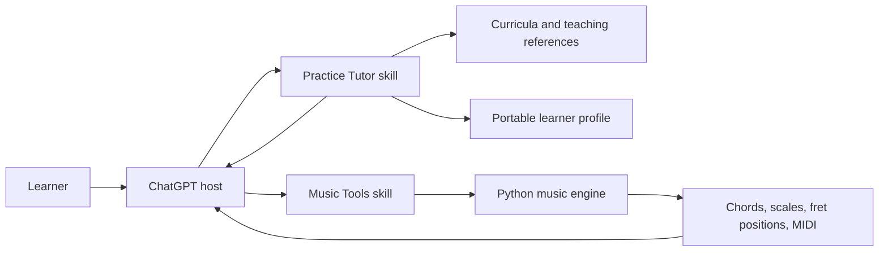

# Practice Room
**An AI practice companion for self-taught piano, guitar and bass players.**

  

Practice Room turns a learner's musical interests, experience, time and constraints into actionable lessons. It combines reusable AI teaching instructions with deterministic music calculations, rather than relying on the language model for every musical fact.

## What it does
- Three instrument curricula (24 modules), with transferable music theory and separate skill progress.
- Adaptive lessons, short practice plans, song-learning strategies, quizzes, genre-inspired drills and resource recommendations.
- Portable, user-controlled learner summaries, with self-reported evidence rather than invented performance scores.
- A Python music engine: 10 chord qualities, 7 scales, inversions, standard guitar/bass fret positions, 12 vetted guitar shapes and original MIDI exercises.
- Four named MIDI tracks: tempo, practice part, harmonic backing and click. Type 1, 480 PPQ, no program changes or bank selects.

## Start here
**ChatGPT:** use the separately distributed plugin ZIP with Plugin Creator, or a supported plugin upload workflow. See [setup](docs/setup.md). This repository is a prepared skills-only Agent Plugins package; installation and directory approval have not yet been verified. No external MCP server, API key or hosting required. Script execution depends on the host.

**Local music tools:** extract this repository and run from its root with Python 3.10+ (no dependencies).

```bash
python skills/music-tools/scripts/music.py chord Eb maj7 --inversion 1
python skills/music-tools/scripts/music.py fretboard bass A minor-pentatonic --frets 7
python skills/music-tools/scripts/music.py shape Am
python skills/music-tools/scripts/music.py exercise piano C --kind major --bpm 65 --bars 8 --out practice.mid
python -m unittest discover -s tests -v
```

Open the generated MIDI in any compatible DAW and assign sounds to tracks. To play along, mute the practice part. The click is on MIDI channel 10. Examples for all three instruments are in [`examples/`](examples/).

## Example interaction
> I'm new to bass, love melodic post-punk, and have 15 minutes a day. Teach me a first lesson and generate a backing track at 75 BPM.

The tutor establishes a baseline, gives an exercise with exact notes/frets, keeps practice time realistic, and adapts to the student's report. The engine supplies validated note data and a MIDI file when execution is available. See [demo](docs/demo.md) for a repeatable interview walkthrough.

## Architecture


| Area | Implementation |
|---|---|
| `plugin.json` | Portable plugin manifest |
| `skills/practice-tutor/` | Onboarding, curriculum, adaptive teaching and progress |
| `skills/music-tools/` | Music reference skill and deterministic Python CLI |
| `examples/` | Generated MIDI and corresponding note data |
| `tests/` | Automated theory and MIDI tests |
| `docs/` | Setup, demo, manual evals, test evidence, privacy |
| `.github/workflows/` | GitHub Actions test workflow |

## Verification and limits
13 automated unit tests passed locally; see [test log](docs/test-results.txt). Tests cover pitch spelling, all supported intervals/roots/inversions, guitar shapes, fret positions, MIDI structure/timing/note pairing and manifest basics. The model's teaching responses and actual installed-plugin behavior require separate manual acceptance testing ([cases](docs/evaluation.md)). This release does not provide microphone listening, automatic performance grading, copyrighted song transcription, cloud persistence or guaranteed script execution in every ChatGPT environment.

## Project status
v1.8.0 is the first packaged prototype, not a claim of prior published versions. Next: installed-host acceptance tests, user feedback, and improved visual tools. See [changelog](CHANGELOG.md). No affiliation with OpenAI or referenced artists.

[Privacy and scope](docs/privacy.md) · [Publishing instructions](docs/setup.md)
